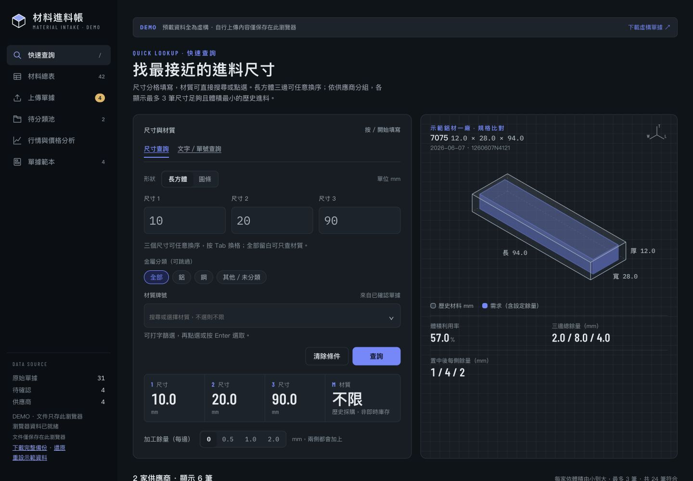
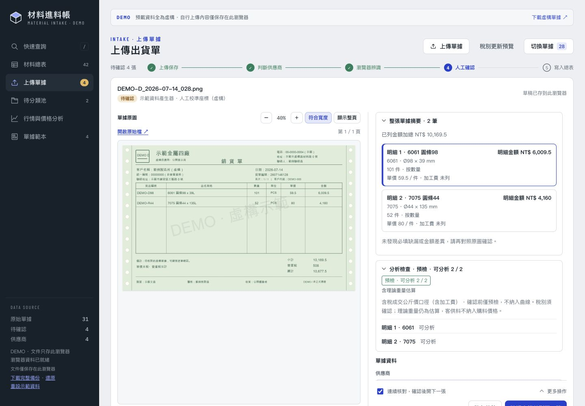
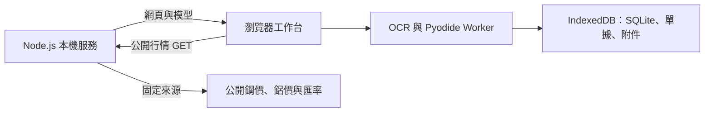

# 材料進料帳 · Demo

[](https://github.com/JimLuie/material-intake-demo/actions/workflows/ci.yml)
[](LICENSE)

以虛構資料體驗材料進料、單據核對與價格分析。瀏覽器內執行繁體中文／英文 OCR 與 Python 計算，資料由各自的瀏覽器保存。

A local-first material intake demo with in-browser OCR, Python/WebAssembly calculations, and synthetic purchasing documents.

**[立即體驗公開 Demo](https://material-intake-demo.dewy-gleam-7201.chatgpt.site)** · [操作與資料說明](docs/usage.md) · [開發指南](CONTRIBUTING.md)



## 本機啟動

安裝 **Node.js 22.13 以上**（含 npm）。一般使用不需要 Python、Docker、API 金鑰或雲端帳號。

```sh
git clone https://github.com/JimLuie/material-intake-demo.git
cd material-intake-demo
npm ci
npm start
```

開啟 **http://127.0.0.1:4173**。也可從 GitHub 的 **Code → Download ZIP** 下載，解壓縮後在專案目錄執行最後兩行。

- 首次安裝與啟動需要網路，會準備瀏覽器執行檔與兩個經 SHA-256 校驗的 OCR 模型；畫面與終端機會顯示進度。
- 準備完成後，開著本機服務即可離線查詢、辨識與核對。行情更新需要網路。
- 若下載中斷，確認網路後重新執行 `npm start`；已驗證的模型會重用。
- 按 `Ctrl+C` 停止服務。連接埠被占用時可用 `npm start -- --port 4174`。
- 只接受本機連線，不提供區域網路共用、GitHub Pages 或 Docker 部署設定。

## 可以體驗什麼

| 功能 | 內容 |
| --- | --- |
| 材料查詢 | 長方體／圓條、加工餘量、材質篩選、立體尺寸比對、材料總表 |
| 單據核對 | 實際 OCR、多頁原圖、自動儲存、逐筆確認、待分類池與垃圾桶 |
| 計價與稅務 | 件數／重量計價、加工費、含稅／另加稅、整單稅額分攤、客供料 |
| 價格分析 | S50C、6061、7075 成交公斤價、並排比較、詢價與附件 |
| 匯入匯出 | CSV、Excel 複製、完整備份、備份還原、重設示範資料 |
| 公開行情 | SteelBenchmarker 鋼價、World Bank 鋁價、央行日／月匯率；來源失敗保留既有快取 |

預載 **31 份單據、42 筆已確認材料、3 筆報價**，涵蓋四種供應商版型、多月採購、多頁、客供料及待核對情境。公司、聯絡資訊與交易紀錄全部虛構，單據以程式重新繪製。



支援 JPG、PNG、WebP、HEIC／HEIF、TIFF、PDF；每份最多 50 MB，PDF 最多 20 頁。複雜或模糊單據可能需要人工補填；辨識不確定的欄位不猜填。PDF 應為同一張單據的多頁，不同單據請分開上傳。

## 資料保存在何處

單據在瀏覽器 Worker 內辨識與計算，SQLite、原檔及附件由 IndexedDB 保存。Node.js 只提供程式資產與固定公開行情代理，不接收單據，也不保存採購資料庫。

- 沒有帳號、共用帳本或跨裝置同步；同一瀏覽器一次開一個操作分頁，避免互相覆寫。
- 瀏覽器、網址與連接埠不同，資料便分開保存。`localhost` 與 `127.0.0.1` 也屬於不同儲存區，請固定使用啟動時顯示的網址。
- 公開 Demo 與本地版的帳本分開；需要搬移時使用完整備份與還原。
- 清除網站資料、關閉無痕工作階段或瀏覽器回收儲存空間，可能失去資料，請定期下載備份。
- 自行上傳的內容不會自動去識別化。請勿將真實單據或備份提交到儲存庫、Issues 或 Pull Requests。

備份、還原與重設位於左側下方；窄視窗請展開頂部「資料工具」。重設需確認，只影響目前瀏覽器的帳本。

## 架構與開發



主介面保留既有 HTML／CSS／JavaScript 設計。Python 規則透過 Pyodide 執行，Tesseract.js 負責 OCR，PDF.js、libheif、UTIF 負責解碼。執行檔與模型在準備後由同一本機服務提供，不依賴執行時 CDN。

唯一的伺服器資料端點是 `GET /api/public-market?source=…`，允許 `steel-history`、`steel-recent`、`aluminium`、`fx_monthly`、`fx_daily`。它不接受任意網址。其餘帳本介面在瀏覽器內執行。

```sh
npm test
npm run test:smoke
npm run audit:release
```

需要驗證原生 Python 與瀏覽器運算一致性時，額外安裝 Python 3.11 以上，再執行：

```sh
npm run test:core
npm run test:wasm
```

GitHub Actions 在 Windows、macOS、Linux 驗證乾淨安裝、資產準備、服務啟動與測試。支援目標、已做的人工驗證與限制詳見 [驗收說明](docs/verification.md)。

## 授權

本專案程式與自行製作的虛構單據採 [MIT License](LICENSE)，Copyright © 2026 JimLuie。

第三方程式、模型與字型沿用各自授權，見 [第三方資源](THIRD_PARTY.md)。公開行情保留來源與觀察日期，屬參考資料；一般鋼材行情並非 S50C 的直接報價。
